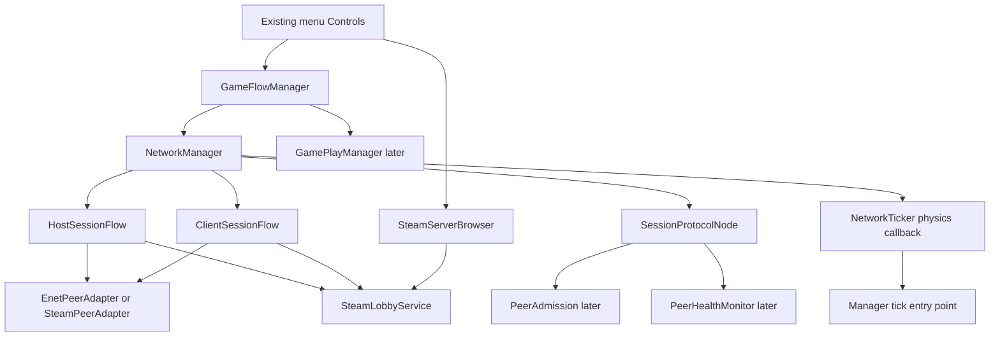

# Network vertical slice refinement plan

Status: discussion draft, 2026-10-31. Architecture and story refinement only.

**Cross-story performance requirement:** target stable operation at the 30 ms network interval for a co-op session of typically 5 players, at most 10. Avoid unnecessary allocations in recurring tick, message and health paths; reuse bounded storage where useful and do not explicitly force GC. Validate timing and GC impact on the actual engine under representative load. This is a practical multiplayer performance requirement, not an absolute prohibition on allocations or automatic collection.

**Connection timeout:** use `GameConfig.ConnectionTimeout`, in milliseconds, loaded from `[general] connection_timeout` (currently `60000`). Capture it for each attempt rather than hardcoding another connection timeout. Diagnostic exchange, gameplay-phase and health deadlines remain separate.

**Host/client error exit:** for a failure that ends the local attempt/session, invalidate it and perform the manager's idempotent resource cleanup, then route through `GameFlowManager.Instance.QuitToStartMenuBlocking(reason)` (`showAsError` defaults to `true`). Flows/adapters report errors; `GameFlowManager` owns navigation. A rejected or failed remote client does not exit the healthy host or other clients. Reserve `GameFlowManager.Instance.QuitWithOsError(reason)` for genuinely unrecoverable whole-game failures, not ordinary connection, timeout or session errors. Scene changes already free outgoing scene Nodes; use their lifecycle cleanup without duplicating it. Explicitly release session resources that survive navigation, including persistent-owner state, peers, lobby membership and outstanding callbacks.

## Refinement tracker

This tracks discussion agreement, not implementation completion. Resume with the first unfinished row in a new context.

| Story | Refinement status | Agreed scope / next discussion |
| --- | --- | --- |
| NET-14 diagnostic exchange | Finished | Seven-step request/reply sequence accepted; roster synchronization deferred beyond this epic |
| Host setup | Finished | Setup completes once; manager owns the running session; client departure preserves host; diagnostic hosting remains separate from public gameplay publication |
| Client connection | Finished | Explicit target through actual connection and diagnostic exchange; cancellation/retry and pinned-host loss; configured timeout and shared error-exit contract |
| Lobby discovery | Ready | Next chat: refine lobby-list ownership, discovery filters, snapshots, selection and handoff to joining |
| Heartbeat and RTT | Pending | Review after lobby discovery |

Handoff: continue refinement with **Lobby discovery**, using this tracker and [the lobby-list plan](network-lobby-list-implementation-plan.md). Discuss before changing proposals; record agreed decisions concisely. No networking implementation has been completed by these refinement discussions.

Roster synchronization is future work: see the [short follow-up plan](network-roster-synchronization-plan.md). The controller/roster proposals below are retained as discussion background only; they do not add requirements to the current message-exchange epic. The physics-loop ticker requirement still applies.

The epic proves that a host and a separate client can connect and exchange an application message. Use a correlated request and reply so both processes demonstrate reception. A connected socket, Steam lobby membership, or local method call alone does not satisfy the epic.

Start with **NET-14: Host and client exchange a diagnostic message**. This enabling story crosses the host and client boundaries and establishes the smallest usable architecture. Then refine host setup, client connection, lobby discovery, and health against that working path.

The proposed transport order is ENet on loopback first, then the same exchange through Steam on the exact custom engine. Steam is the proposed completion gate given the [project stack](../../sMPGWM.Game/README.md); confirm that scope during discussion. ENet gives a repeatable local development path without waiting for two Steam accounts/devices.

## Introductory discussion about player controllers and ticking

Proposal from the multiplayer-manager design: every participating player has exactly one local `MpController` Node on every process. A three-player session therefore has three controllers on the host and three on each client, nine local Nodes in total. The dictionary is global within a process; its contents are coordinated across processes by host-owned roster messages.

Preserve that requirement while discussing who owns the dictionary, when a connected peer becomes a participant, how the roster reaches existing and newly joining clients, and who drives each tick. A controller must enter and leave the Godot scene tree so future derived classes receive the engine lifecycle. Construction alone is insufficient.

The requirements to represent every participant and to use the fixed-rate physics loop as the ticker source are user direction. Registry ownership, role mapping, roster protocol and tick dispatch wiring below remain proposals to settle before implementation. Carry the physics-loop requirement through every story; carry the remaining decisions once adopted.

Two decisions deserve discussion first:

1. **Participation boundary (deferred):** should controllers appear on transport connection, or once the host explicitly accepts a player into the roster? Proposed: host-approved participation. Failed/pending connections do not create player controllers. Settle this after the current epic; NET-14 has no roster participation gate.
2. **Tick dispatch:** use `_PhysicsProcess` as the ticker source, as in the supplied reference. Proposed wiring: one session-owned `NetworkTicker` dispatches each physics step through the owner to ready controllers. The exact physics frequency and any lower packet-send cadence remain to be settled separately.

## Architecture to discuss and adopt

### Global registry and controller ownership

`NetworkManager` owns an instance dictionary keyed by the participant's Godot peer ID and exposes it globally through the existing persistent owner. Other classes can use a static convenience accessor for lookup. Prefer a read-only view publicly; only the session owner creates, removes or replaces entries. This retains global access while making cleanup and duplicate prevention one component's responsibility.

The suggested `MpControllers => MpControllers` accessor recursively calls itself. It must point to a backing dictionary or the owner's property. Conceptually, once the corresponding owner properties exist:

```csharp
private static IReadOnlyDictionary<int, MpController> MpControllers
    => GameFlowManager.Instance.NetworkManager.MpControllers;
```

The backing collection remains `Dictionary<int, MpController>`. Read-only exposure does not make a controller immutable; it prevents unrelated callers from changing membership. All mutations and Node operations occur on the main thread. The collection includes the local player, uses connection identity rather than Steam identity, and is empty after session teardown. A rejoin creates a fresh controller for the new participation; it does not revive a freed Node.

Proposed tree ownership:

```text
GameFlowManager
  NetworkManager
    SessionProtocolNode
    NetworkTicker
    Controllers
      Player_<host peer ID>   : MpController
      Player_<client A ID>    : MpController
      Player_<client B ID>    : MpController
```

`Controllers` is an ordinary container Node. It keeps controller lifetime tied to the session rather than to a menu or gameplay scene. Gameplay bodies/avatars can later attach to the active world and bind to controllers. Scene changes must explicitly unbind world references; persistence does not make old references valid.

`MpController : Node` starts as an empty concrete partial class. Once behavior is needed, it can become an abstract partial base with concrete role implementations. Identity and activation hooks can be added when the roster/tick wiring needs them. No avatar, movement, input authority or gameplay readiness is implied by the empty Node.

Proposed future role selection uses local context and the represented player:

| Local process | Host player | Client A | Client B |
| --- | --- | --- | --- |
| Host | `HostController` | `ClientDummyController` | `ClientDummyController` |
| Client A | `HostDummyController` | `ClientController` | `ClientDummyController` |
| Client B | `HostDummyController` | `ClientDummyController` | `ClientController` |

All four derive from `MpController` and run through Godot's lifecycle. Dummy means a representation of another player in this local context. It does not determine simulation authority: the host remains authoritative for client players too. A local `ClientController` may later collect input and predict; its class name alone never authorizes shared-world changes. Confirm this mapping before implementing subclasses.

### Roster wiring and lifecycle

The host owns participant membership. `SessionProtocolNode` receives bounded roster messages from the host and delegates local application to `NetworkManager`. Adapters report connections and loss, but they do not instantiate controllers. Clients cannot announce arbitrary player Nodes or independently choose the authoritative roster.

Proposed roster flow:

1. Host becomes a participant and creates its local controller without self-RPC.
2. Host accepts a new participant, creates its controller once, and sends the joiner a complete roster including host, existing clients and the joiner. Existing clients receive a roster update for the newcomer.
3. Each process reconciles host session identity and roster revision, creates only missing controllers, configures them before adding them to the tree, and registers them once lifecycle readiness is satisfied. The same roster delivered twice creates no duplicates. A controller is eligible for tick dispatch only after local readiness.
4. Use one reliable ordered roster stream with a snapshot/revision baseline so changes during a join cannot be lost or older updates applied after a newer roster. Peer events and RPC ordering on the custom build are verification inputs, not a substitute for host membership authority.
5. On departure, stop participation/tick dispatch, remove the registry entry, detach bindings and queue the Node for deletion. Other processes apply the host's roster removal. The host session and other controllers remain alive.
6. On teardown, invalidate the session, stop dispatch and clear all entries before freeing controller Nodes. Unexpected controller exit must reconcile the matching entry without deleting a newer replacement for the same key.

During node attachment, keep any reservation for a peer ID outside the published ready-controller dictionary so reentrant/duplicate roster application cannot create another Node. Lifecycle readiness is separate from gameplay admission and remains subject to cancellation/session checks. The three-controller invariant holds once roster reconciliation completes; it cannot hold instantaneously across machines during joins, leaves or a partition.

Roster synchronization and real controller Nodes are deferred beyond the message epic. This proposal does not replicate a world or spawn a gameplay avatar. The earlier logging-only spawn seam remains about gameplay spawning.

### Tick loop discussion

**Confirmed carryover:** use the constant configured rate of Godot's physics loop as the ticker. The supplied [legacy NetworkTicker](../../sMPGWM.Game/Scripts/Network/NetworkTicker.cs) is reference code for this decision. Replace the earlier proposal to dispatch network ticks from frame-based monotonic due times. No independent timer or frame accumulator determines the tick rate.

Proposed implementation: a persistent `NetworkTicker : Node`, owned by `NetworkManager`, calls the owner's tick entry point once from each `_PhysicsProcess(delta)` while the session is active. The manager applies pending changes and dispatches to a stable set of ready controllers. The ticker only supplies local tick number and physics delta; session policy, controller membership, health and RPC definitions remain with their respective owners.

| Schedule | Proposed owner and work | Controller involvement |
| --- | --- | --- |
| Frame processing | Godot frame callbacks; presentation and UI | Controller `_Process` can later handle presentation/interpolation; it does not drive the network tick |
| Physics/network tick | One `NetworkTicker._PhysicsProcess` callback per local physics step; manager advances tick work and dispatches ready controllers | Explicit tick callback when behavior exists; do not repeat that work in each controller's own `_PhysicsProcess` |
| Packet send cadence | Protocol sends immediately for control, or at a separately agreed cadence from physics steps for future state updates | A physics tick need not produce a packet; state publication follows completed simulation |
| Control and liveness | Persistent protocol endpoint receives/replies promptly; manager advances health/setup deadlines from the physics ticker using real monotonic time | Empty controllers are not required to answer health probes or complete setup |

Godot frame processing varies with rendered frames; physics processing has its own fixed-rate setting. Inheriting Node does not require one timer per controller. See [Godot processing](https://docs.godotengine.org/en/4.6/tutorials/scripting/idle_and_physics_processing.html) and [Node lifecycle](https://docs.godotengine.org/en/4.6/classes/class_node.html).

Proposed physics-tick order: apply validated queued membership/control changes, check session/health deadlines, dispatch the local tick to ready controllers, then publish any due state from completed simulation. Mutations raised during dispatch are queued until the boundary; a controller marked for removal is skipped. Keep ordered controller iteration if later behavior needs reproducibility; dictionary iteration is not an agreed simulation order. Future physics-body integration/order must be verified when actual simulation is introduced.

The README's 60 FPS frame cap does not select the physics frequency. Its 30 ms network interval also cannot describe a tick on every physics step at 60 Hz: that step is about 16.67 ms. Decide whether 30 ms remains a separate packet-send target or is replaced by the selected physics tick contract. For example, sending every second 60 Hz physics step gives 30 sends/second, about 33.33 ms, not 30 ms. Leave the README values unchanged until that frequency decision is made.

The engine schedules physics steps; do not add a second simulation catch-up loop to the ticker. During catch-up, future state publication should avoid sending a burst of obsolete snapshots. Fixed-step scheduling is not a promise of uninterrupted wall-clock execution: stalls still delay processing. Tune/test engine catch-up and simulation overload behavior with actual gameplay.

Keep Godot's normal multiplayer polling initially and verify it on the custom peer. Do not also poll manually from the ticker. Control messages, diagnostic replies and health responses need not wait for a periodic state packet. Future gameplay RPCs validate/enqueue inputs for the simulation boundary instead of moving physics bodies inside receive handlers.

Each process advances its own local physics tick. Keep it separate from the latest observed host tick and any future estimate of the current host tick. Received host tick messages are observations, not instructions to execute another local simulation step. Lost or delayed host tick packets must not stop or double-drive the client's loop. Keep tick counters and subscriptions session-scoped rather than static across attempts.

Carry over the physics source from the reference, but replace its static `HostDelta` event, static mutable counters and RPC-based client tick delivery. In particular, clients must not depend on receiving `EmitTick` to advance controllers. Keep RPC declarations in `SessionProtocolNode`; send host simulation tick information with protocol messages when required. Do not copy the reference's hard overwrite of the local tick when it differs by more than two: clock/tick estimation is separate future work.

RTT is measured from local monotonic send and receive timestamps for a matched probe, not from `delta * tickCount`, remote timestamps or a difference between host/client tick counters. Physics steps schedule health checks; elapsed real time decides deadlines. This remains correct across differing tick origins, engine time scale and stalls. Receiving a matching reply records its timestamp promptly rather than waiting for a controller tick. Configure the persistent ticker/endpoint for supported pause processing while gating gameplay dispatch separately, so health can continue when gameplay is paused.

For NET-14, prove physics-driven manager tick dispatch in both processes without requiring incoming tick packets. Controller creation/readiness/removal and roster checks are deferred beyond this epic. Do not implement movement, prediction or tick correction to exercise the loop.

### Carryover after adoption

Deferred follow-up only: this table does not amend the current epic's accepted stories.

| Story area | Required amendment once decisions are adopted |
| --- | --- |
| NET-01 ownership | Own and globally expose the registry; define controller container, factory location, session-owned physics ticker and teardown |
| NET-14 first exchange and NET-08 protocol | Add host roster snapshot/update messages, ordering/session checks and controller convergence; keep diagnostic success distinct from gameplay admission |
| Host and NET-02/03 transport | Create host participation once; hand actual remote connections to the participation gate; no controller construction in adapters |
| Client and NET-09 admission | Bootstrap the complete roster; instantiate each local role once; later use admission as the participation gate and keep roster updates consistent for existing clients |
| NET-04/05 browser and menus | Browsing/selection creates no controller; menu return removes all session controllers; a new join starts cleanly |
| NET-06/07 initialization | Controller Node readiness and effective gameplay readiness are separate conditions; bind the current world explicitly |
| NET-10/13 spawn and world seam | Separate persistent participant controllers from avatar spawning/world replication; reconcile the old logging-only wording |
| NET-11 health | Advance checks from the physics ticker using monotonic timestamps, not tick counts; keep probes session-owned; route removal through roster/registry cleanup |
| NET-00/12 verification | Verify physics dispatch without incoming tick packets, callback/readiness order, no duplicate Nodes/ticks, pause/stalls, late join, three-player counts, departure/rejoin and teardown |

The architecture below remains the earlier baseline. Extend its diagram/table with the controller container and scheduler once these proposals are adopted; do not treat their current omission as a rejection of the requirement.

### Session services and their responsibilities



Arrows show collaboration. `NetworkManager` owns the flows, active transport, protocol endpoint and session state. The lobby service has a persistent lifetime that can outlast a canceled attempt or a hidden browser so it can drain late native callbacks. The existing `SteamworksHelper` owns Steam initialization, callback pumping and shutdown; session cleanup precedes runtime shutdown.

| Class or type | Responsibility and lifetime | Boundary |
| --- | --- | --- |
| `GameFlowManager` | Existing persistent Node; create the network owner, submit requests, await outcomes, coordinate navigation and later gameplay activation | Does not construct native peers or interpret RPCs |
| `NetworkManager` | Persistent child Node; own one active attempt/session, attach the peer, track connection state, tick plain classes, route loss/removal, perform idempotent teardown | Does not render UI, discover rows, hash gameplay data or implement every flow step |
| `NetworkTicker` | Persistent child Node; use `_PhysicsProcess` as the single local tick source and call the manager's tick entry point | No RPC declarations, per-controller timers, static global tick state or packet-driven client simulation |
| `SessionProtocolNode` | Persistent deterministically named child Node; declare RPCs, capture actual sender, validate bounded wire fields and delegate | Same path on both processes; exists before peer assignment; contains no navigation or native lobby operations |
| `HostSessionFlow` | Plain C# class; sequence one host setup using immutable settings and cancellation | Requests resources from adapters/services; does not independently own global peer assignment |
| `ClientSessionFlow` | Plain C# class; sequence one join, distinguish lobby membership from actual transport connection | Receives a target; does not search for one or claim gameplay admission |
| `EnetPeerAdapter` | Plain C# class; construct ENet peer, check immediate errors, observe connection/loss, close/dispose its resources | Reports outcomes; manager alone installs or clears the active peer |
| `SteamPeerAdapter` | Plain C# class; safely construct and call the custom native peer, observe connection/loss, close/dispose it | Lobby membership and metadata belong to the lobby service |
| `SteamLobbyService` | Plain persistent service; serialize native operations, track memberships, read/write metadata, drain canceled operations | Browser cancellation must not abandon successful late membership |
| `SteamServerBrowser` | Plain C# class; turn discovery results into immutable snapshots and manage refresh publication | Does not join a lobby or own a game peer |
| `PeerAdmission` | Later plain state machine; per-peer readiness, compatibility and admission decisions | Transport connection is an input, not admission success |
| `PeerHealthMonitor` | Later plain state machine; bounded probes, local monotonic deadlines, RTT and expiry requests | Requests removal through manager; does not navigate or close peers itself |
| `GamePlayManager` | Existing scene Node; later return explicit initialization completion and activate only after admission | Scene arrival and `_Ready` alone cannot authorize input |
| `GameplayCompatibilityPolicy`, `SessionFingerprint`, `ChecksumGenerator` | Later typed comparison policy, immutable effective-data result and pure hashing utility | Hashing has no UI, file-selection policy or shutdown behavior |
| `WorldJoinCoordinator`, `PlayerSpawnCoordinator` | Later ordinary coordinators for an explicitly named no-replication seam and host-only spawn log | Diagnostic exchange does not invoke either |
| Requests, results, session data, DTOs, enums | Plain immutable data; separate LAN endpoint from Steam lobby target, carry explicit failure/cancellation reasons | No mutable global request inputs or static completion events |

Introduce types as their behavior becomes necessary. NET-14 needs the owner, endpoint, ENet adapter, small flows and request/result types. It needs no browser, health monitor, fingerprint, world coordinator, generic event bus or second session manager. Share transport operations when both adapters reveal a useful common contract; do not preserve `IActiveNetwork.GetNode()` as a constraint.

All engine operations stay on the main thread. The manager owns API signal subscriptions; adapters own any native peer subscriptions they create. Every subscription has one matching detach. API settings belong to the session owner and are restored during teardown. Configure persistent endpoint processing for supported pause behavior; validate background behavior on the real build.

## Relationship to the existing plans

The [shared network plan](network-lobby-implementation-plan.md) and four workstream plans describe a larger running-world admission increment. This refinement proposes a smaller first epic. It preserves their long-term responsibilities and NET identifiers while separating the message exchange from gameplay readiness.

Gameplay fingerprints, explicit gameplay initialization, world synchronization, admission, and spawn logging remain later stories. The first exchange must never be presented as an admitted player or a synchronized world. Host authority and the ability for a client to leave without stopping the host apply from the first story.

The four workstreams are:

| Workstream | Refined outcome | First increment | Later increment |
| --- | --- | --- | --- |
| [Create game as host](network-host-implementation-plan.md) | Own a listening host session and its Steam publication | Start, accept a diagnostic client, stay running after it leaves | Initialize gameplay, fingerprint, local admission, publish a running world |
| [Create game as client](network-client-implementation-plan.md) | Connect to an explicit target and exchange messages | Connect, exchange, cancel, disconnect, retry | Compatibility, scene initialization, world join, gameplay admission |
| [Create the lobby list](network-lobby-list-implementation-plan.md) | Discover targets and hand one selected ID to joining | Optional for the message epic; supply a lobby ID directly first | Real discovery, metadata, selection, search and sort |
| [Heartbeat and RTT](network-heartbeat-rtt-implementation-plan.md) | Measure connected-peer liveness and latency | Optional for the message epic; finite exchange deadline is sufficient | Continuous probes, metrics, timeout removal |

The existing full order makes Steam depend on gameplay initialization and spawning. For this smaller epic, extract basic Steam membership/connection from NET-02; leave **public running-game publication** behind its original gameplay gates. A private diagnostic lobby can be used before those gates exist.

## First story NET-14 host and client exchange a diagnostic message

**Story:** As a developer, I can start a host and a separate client, send a small message from the client, and see its matching reply, so subsequent networking work has a working integration path.

This is the recommended first implementation story. It delivers useful portions of NET-00, NET-01, NET-03 and NET-08 without declaring those larger stories complete. Begin with the small ENet capability check required for the exchange; the complete Steam/auth/channel matrix does not block local development.

**Classes:** `NetworkManager`, `SessionProtocolNode`, `HostSessionFlow`, `ClientSessionFlow`, `EnetPeerAdapter`, immutable host/join requests and operation results. Use a small developer scene or explicit launch arguments to start both roles through these production classes. The harness chooses inputs and displays evidence; it must not contain another connection implementation.

**Sequence:**

1. Create the persistent owner and identically named RPC endpoint in both processes. Subscribe to connection/loss signals before assigning a peer.
2. Host starts listening and reports `Listening` without waiting for a client. Record a fresh diagnostic session identity. Capacity includes the host.
3. Client submits a validated LAN endpoint. Check peer creation immediately and then await actual connection with cancellation and a finite timeout.
4. Client sends a bounded reliable `DiagnosticHello` with protocol version, a fresh correlation ID and a small text payload to the host.
5. Host captures the actual sender synchronously, verifies the sender belongs to its current connection set and the message fits the diagnostic contract, records receipt, and sends `DiagnosticReply` to that sender with matching correlation ID and host session identity.
6. Client accepts a reply only from its connected server, for its current attempt and outstanding correlation ID. Both processes log role, actual sender, message kind and correlation ID. Only then report `MessageExchangeSucceeded`.
7. Client leaves; host keeps listening. A new client attempt can repeat the exchange. Cancel/exit invalidates the attempt before clearing its owned peer and subscriptions.

These messages are allowed only in the diagnostic path. They cannot authorize gameplay handlers. A reply confirms an application round trip; it is not the later admission protocol or a continuous heartbeat. Use a bounded wire format of primitives with object decoding disabled. Do not transmit a C# object graph or trust a payload's claimed sender. Check send errors as well as connection outcomes.

**Acceptance:**

- Two separate Godot processes exchange matching request/reply payloads through actual RPCs. A self-call or socket status does not pass.
- Host start succeeds without a client; client departure and a second join preserve the host session identity.
- Occupied port, unreachable endpoint, immediate client-creation error, exchange timeout and cancellation produce one explicit terminal result and release owned resources.
- Duplicate starts are rejected; late signals/replies cannot complete a canceled or newer attempt. Wrong-sender, unsupported, oversized and unmatched replies cannot report success.
- The same path can be run again after teardown. Record executable/build, launch inputs and both process logs.

**Implementation order inside the story:** record baseline build status; make the minimal owner/endpoint and ENet host compile; connect a second process; deliver request/reply; verify teardown/retry and failure cases. Resolve native RPC/path questions with this harness. Keep the game scene out of this first proof so its current unconditional activation does not imply admission.

## Host story refinement

**Architecture:** `GameFlowManager` submits a `HostSessionRequest`; `NetworkManager` owns the attempt; `HostSessionFlow` sequences adapter and optional lobby work. Listening, diagnostic exchange readiness, gameplay readiness and public publication are separate outcomes.

For Steam, `SteamLobbyService` records successful membership, creates a private unjoinable lobby, writes bounded identity/protocol/session metadata and pins the original host. `SteamPeerAdapter` validates the native object and peer creation. Only the manager assigns the peer. Creator `LobbyJoined` is bookkeeping and cannot complete hosting again. A private diagnostic lobby may become joinable for the supplied-ID test once its diagnostic endpoint is usable; it is never advertised as a ready running game.

Later, `GameFlowManager` loads gameplay and awaits `GamePlayManager` initialization. Local host admission does not use self-RPC or wait for another player. Public `state=ready` publication remains gated by the existing gameplay fingerprint/initialization/local-admission contract.

**Refinement discussion:** settle the host request fields and result names, resource handoff from adapter to manager, the point at which host setup completes, and capacity accounting for pending peers. Use one owner for teardown; a client setup failure removes that client rather than ending the host.

**Acceptance demonstration:** start a host alone, join and leave twice, cancel preparation, fail peer creation/publication and retry. For the message epic, show Steam request/reply using a supplied lobby ID. Full public running-world readiness is demonstrated in the later gameplay stories.

## Client story refinement

**Architecture:** a menu or harness supplies a `JoinSessionRequest` containing a LAN endpoint or selected Steam lobby ID. `ClientSessionFlow` handles setup; the adapter reports transport connection; `SessionProtocolNode` handles messages. Browser selection, lobby membership, transport connection and gameplay admission each have distinct meaning.

For Steam, join through the lobby service, record membership immediately, revalidate metadata and pin the original host/session, then connect the peer to that host. The original host leaving ends the client session even if Steam transfers lobby ownership. Cancellation retains enough operation ownership to leave a lobby after a late successful callback.

The diagnostic increment stops after the correlated exchange. Later `PeerAdmission` implements both host and client ends of `HostReady -> ClientReady -> world-join result -> AdmissionAccepted`. `GamePlayManager` supplies explicit local readiness; `WorldJoinCoordinator` supplies the named stub result; `PlayerSpawnCoordinator` logs once per admitted peer. Keep phase deadlines independent from health replies.

**Refinement discussion:** agree connection versus gameplay result names, which failures return to the menu, fresh attempt/connection identity on retry, and how pending messages survive a scene change through the persistent endpoint. Capture actual sender before any await.

**Acceptance demonstration:** connect to an explicit target, exchange, cancel and retry; reject stale/full/self targets and host departure. Later demonstrate compatibility rejection, duplicate readiness/acceptance without duplicate activation and one failed client alongside a healthy client.

## Lobby list story refinement

**Architecture:** `SteamServerBrowser` requests immutable entry snapshots from `SteamLobbyService`. Existing menu and row Controls render them and own selection. A selected ID becomes client-flow input. Neither browsing nor selection allocates a peer or joins a lobby.

Keep service lifetime independent from screen visibility. Hidden history screens can remain in the tree, so activate/deactivate browser subscriptions explicitly. Serialize refreshes according to the installed callback contract and drain canceled work. Apply native game/version/protocol/build filters on every request; search and sorting operate on the snapshot.

**Refinement discussion:** agree the entry fields shared with host publication, loading/empty/error/inactive states, stable-ID selection and admitted-player count semantics. Keep membership count distinct from admitted players. Do not show connected-peer RTT as browser ping.

**Acceptance demonstration:** fixture snapshots cover display and keyboard selection before Steam is ready; real discovery later finds a published host, hands its ID to the existing client flow and completes the exchange. Refresh/filter removal clears selection; sort preserves it. Browser deactivation prevents late UI updates without destroying service drain ownership.

This story follows the supplied-ID Steam exchange. It becomes an epic requirement only if discovery through the actual Join screen is included in the completion scope.

## Heartbeat and RTT story refinement

**Architecture:** `PeerHealthMonitor` is plain per-session logic driven by `NetworkManager` and a monotonic clock. `SessionProtocolNode` carries probes/replies; the manager owns connection removal. Existing UI consumes immutable metrics. No peer Nodes, peer Timers or new autoload are required.

Use one correlated probe exchange for both liveness and RTT. Store local send time, consume a matching reply once, compute local elapsed time and update metrics. Invalid, stale, duplicate, wrong-session and wrong-peer replies cannot refresh health. Start health after preflight and permit it during loading; gameplay phase deadlines remain independent.

**Refinement discussion:** choose interval/deadline/grace values after loading measurements, verify channel behavior on the custom engine and agree stale/unavailable metrics. Retain the proposed 2-second interval, 10-second deadline and EMA alpha 0.125 as initial values to validate. A blocked main thread cannot run its own watchdog.

**Acceptance demonstration:** deterministic clock checks include 100 ms then 180 ms producing 110 ms smoothed RTT, stale/reset/out-of-order handling and bounded storage. Real-process checks cover pause, delay/loss and congestion. Host expiry removes only the affected client; client expiry exits that client's session.

This follows the working exchange. NET-14's one-shot deadline provides its own completion bound without implementing continuous health first.

## Existing story coverage and proposed delivery order

Each existing story keeps its identifier. Partial work in NET-14 is evidence and reusable implementation, not completion of every related story.

| Story | Main classes and responsibility | Place in delivery |
| --- | --- | --- |
| NET-00 native verification | Harness, adapters, protocol endpoint; record exact-build signal/RPC/auth/channel/identity behavior | Minimal ENet proof inside NET-14; Steam checks before relying on those features; complete matrix later |
| NET-01 ownership | Manager, flows, immutable requests/results; one attempt, peer owner and teardown | Minimum inside NET-14, extend with each resource added |
| NET-02 Steam | Lobby service, Steam adapter, host/client flows; membership, host pinning, callback drain, publication | Private supplied-ID exchange after NET-14; public running-world publication after gameplay gates |
| NET-03 ENet | ENet adapter and request validation; endpoint, capacity, actual outcome, cleanup | First transport inside NET-14; finish full edge-case acceptance afterward |
| NET-04 discovery | Browser and lobby service; filtered snapshots and refresh lifetime | After supplied-ID Steam connection; optional for minimum epic |
| NET-05 menus | Existing menu/entry Controls and GameFlowManager; requests, selection, status and Back | Thin inputs first if useful; browser UI follows NET-04 |
| NET-06 compatibility | Typed policy, fingerprint and pure checksum utility; effective gameplay equality | Follow-up gameplay admission increment |
| NET-07 initialization | GamePlayManager and GameFlowManager; explicit readiness and gated activation | After NET-06; not needed for a diagnostic session |
| NET-08 protocol | Protocol endpoint, bounded codecs and peer state; preflight, sender/session validation | Diagnostic subset in NET-14; select native auth or evidenced bounded RPC preflight after verification; full admission envelope later |
| NET-09 admission | PeerAdmission, flows and protocol; matching readiness and one admission decision | After compatibility, initialization and world-join contract |
| NET-10 spawn seam | PlayerSpawnCoordinator and gameplay activation; host-only log, activate once | After NET-09; never part of diagnostic success |
| NET-11 health | PeerHealthMonitor, metrics and protocol; liveness, RTT, removal request | After verified preflight; diagnostic-only use need not wait for gameplay admission |
| NET-12 integration | Production flows plus repeatable harness; restart/retry/isolation/host-loss evidence | Minimum two-process repeatability inside epic; full gameplay/three-peer matrix later |
| NET-13 world join | WorldJoinCoordinator; explicit result and per-join cancellation | Before NET-09; remains a no-replication stub until actual synchronization exists |
| NET-14 message exchange | Owner, small flows, adapter and endpoint; end-to-end diagnostic path | **First implementation story** |

Proposed order: **NET-14 ENet exchange -> native Steam checks -> basic Steam host/client exchange -> minimum repeatability and failure checks**. Then extend discovery/menus and health, followed by the gameplay compatibility/initialization/admission stories. Their exact order can change without making fingerprints or browser UI prerequisites for the first message.

## Legacy replacement approach

Use `Scripts/Network` as reference for working API calls and observed behavior, then replace its structure as needed. Preserve LAN configuration and Steam virtual port 0 where confirmed by the harness. Keep namespaces aligned with paths and follow the README's one-file-per-type and no-LINQ guidance.

- Replace `NetworkManager` static completion events and reads of mutable flow inputs with per-attempt requests/results and instance loss events.
- Replace `BaseNetwork` and `IActiveNetwork`; adapters need no scene-tree lifecycle or `GetNode()` contract.
- Split `SteamNetwork` responsibilities into lobby service, Steam adapter and host/client flows.
- Fold useful native wrapper calls into the Steam adapter or a small internal wrapper; construction failure must return failure before dereferencing a native object.
- Use legacy `MpManager` message methods as behavioral reference only. The current file is commented out; the older shared plan's claim that it is uncommented is stale. Record actual baseline build results before inferring blockers.
- Wire `GameFlowManager` explicitly: its current `StartGame` loads immediately and `SceneChanged` sets the target state. Diagnostic connection success must not route through that path as gameplay admission.
- Make Steam startup failure leave ENet usable; current `SteamworksHelper` failure behavior exits the application. Ensure session teardown runs before its shutdown.

## Refinement discussion sequence

1. Agree the epic completion scope: proposed Steam exchange after ENet, with supplied lobby ID sufficient; decide whether real browser navigation is required.
2. Walk through NET-14 and assign each step to its owning class. Settle result names and peer/resource handoff before signatures.
3. Review host and client stories together around cancellation, creator-join callbacks, host loss and retry. Write the message fields once for both ends.
4. Review lobby list and heartbeat as consumers of the established lifecycle; retain their independent acceptance demonstrations.
5. Size the refined increments and record decisions. Keep gameplay admission and real world replication visibly separate from the message epic.

The minimum review evidence is two real processes, matching message logs, client leave/rejoin without host restart, explicit failure outcomes and repeatable cleanup. Runtime capability claims require the exact executable; this planning draft records no executed runtime verification.
